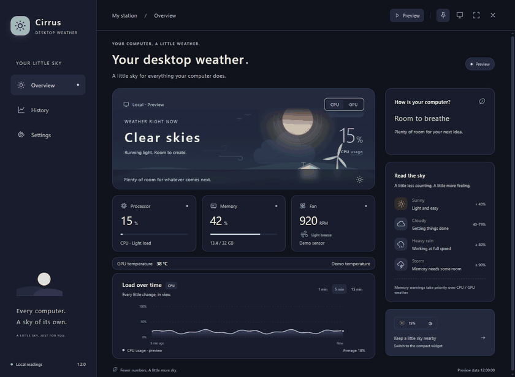
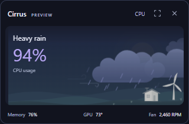

# Cirrus · Desktop Weather

**A Windows tray widget that turns CPU/GPU load into animated weather, high memory use into thunderstorms, and fan speed into wind — entirely offline.**

**[Download for Windows — portable .exe](https://github.com/yeze5421/weather-forecast/releases/download/v1.2.0/Cirrus-Weather-1.2.0.exe)** · [SHA-256](https://github.com/yeze5421/weather-forecast/releases/download/v1.2.0/SHA256.txt) · [Release notes](https://github.com/yeze5421/weather-forecast/releases/tag/v1.2.0)

Windows 10 / 11 · x64 · No installation or account required · MIT License



*A short recording of the actual app, using clearly labeled demo readings.*

## Run

**[Download the latest release](https://github.com/yeze5421/weather-forecast/releases/latest)** for Windows 10 / 11 x64. Download the `.exe` attachment and double-click it. Node.js, Python, .NET, accounts, API keys and servers are not required.

This checkout is **1.2.0 — A Quieter Sky**. Its local portable build is `release/Cirrus-Weather-1.2.0.exe`; `Launch-Cirrus.cmd` opens the most recently built portable executable. GitHub's automatic Source code archives contain source files and require the development setup below.

- Left-click the tray weather icon to open or hide the widget.
- Right-click to select CPU / GPU weather, toggle Always on top, or Quit Cirrus.
- Use the expand button to switch between the widget and full station view.
- Use the monitor button or the tray's Window mode menu for the **320 × 210 mini desktop**. Drag its header to reposition it; the position and mode survive a restart. The mini stays open when it loses focus. Its expand button opens the full station.
- Closing the window hides it to the tray. Use Quit Cirrus to exit completely.
- Windows may place the tray icon under Show hidden icons.

When updating, choose Quit Cirrus from the tray before launching the new executable.

The current executable is unsigned. Windows may show an unknown publisher or SmartScreen prompt.

## How the weather works

| Observation | Weather |
| --- | --- |
| Selected CPU / GPU load below 40% | Clear skies |
| Selected CPU / GPU load from 40% to below 80% | Clouds passing |
| Selected CPU / GPU load at least 80% | Heavy rain |
| Memory reaches the warning threshold, 90% by default | Thunderstorm, with priority over CPU / GPU weather |
| Selected load sensor is unavailable | Awaiting data |

Fan RPM controls the windmill and wind animation. Missing RPM readings leave the windmill still and the value blank. Weather describes current computer activity; it does not predict future load or real-world weather.

**Smooth weather** is on by default. Live skies use readings from the last six seconds, a four-second change hold and a three-point recovery margin. Memory storms take priority after a three-second hold; once a storm starts, memory must fall at least three percentage points below the threshold before recovery begins. The first available reading initializes the sky immediately. Numeric readings and history remain raw. Turning smoothing off uses the table directly; Preview always changes immediately. The tray and window share the same live weather state.

## A quieter desktop companion

- **Energy saving:** visible CPU / memory readings follow your chosen interval. Background and battery modes use at least five seconds; a locked screen uses at least fifteen seconds. NVIDIA polling changes from four seconds to ten / thirty seconds, and fan / fallback polling from ten seconds to fifteen / thirty seconds. Windows fallback GPU polling follows the fan service interval.
- Hidden windows receive no periodic reading pushes and their animations pause. Session history continues in the main process and refreshes when you reopen the window. During sleep, sensor processes stop; wake reconnects them and discards old readings. Energy saving can be disabled; hidden rendering remains paused.
- **Sensor health** in Settings explains missing, stale, disconnected or blocked sensors. Failed processes retry with a capped backoff; unresponsive processes are restarted. Reconnect offers a manual retry, limited to once per ten seconds. Fan readings still require compatible hardware and an available WMI provider.
- **GPU temperature** appears in the overview and mini footer when NVIDIA supplies a reading, and in CSV exports. Other GPU sources leave temperature blank. CPU temperature is not collected.
- **Quiet alerts** are off by default. Enable them in Settings for selected CPU / GPU load at or above 90%, memory at the storm threshold, or GPU temperature at a chosen threshold (85 °C by default). Conditions must persist for 30, 60 or 120 seconds; every alert kind has a fifteen-minute cooldown. Alerts use live data only and are suppressed while the screen is locked. Windows notification settings may suppress delivery. No notification or reading is uploaded.



## Hardware and data

- **CPU / memory:** actual system readings. CPU utilization needs one sampling interval before its first value.
- **NVIDIA GPU:** the driver's `nvidia-smi`, sampled every four seconds in active mode. With multiple NVIDIA GPUs, Cirrus selects the busiest adapter.
- **Other Windows GPUs:** Windows GPU performance counters, sampled every ten seconds in active mode, using the busiest physical engine. Unsupported drivers leave the reading unavailable.
- **Fan RPM:** WMI `Fan` sensors exposed by a running LibreHardwareMonitor / OpenHardwareMonitor instance. The highest available RPM is used. Availability depends on the hardware, provider and permissions. Cirrus installs no drivers and does not control fans. GPU fan percentages are not treated as RPM.
- The sampling setting controls CPU / memory and UI updates. GPU / fan sampling uses the separate intervals above, adjusted by Energy saving.
- Preferences and readings stay on this computer. There is no account, remote API, telemetry upload or automatic update service in the application code.
- History retains the last 30 minutes of the current session and clears on exit. CSV export is an explicit user action. Preview and live records are kept separately.

## Make it yours

Choose **Midnight**, **Obsidian**, **Forest**, **Ember** or **Daylight** in Settings → Appearance, or from the tray menu. Each theme colors the whole interface, charts, clouds and landscape. Your choice is saved locally and restored on the next launch. Midnight is the default.

## Preview

Open Preview to try sunny, cloudy, rainy and stormy skies without changing actual computer load. The interface labels demo readings as Preview. Back to live readings returns to real data. Browser mode supports previews; live hardware readings require the desktop app.

## Develop and build

Use Node.js 22.12+ and npm. Node.js 24 has been tested.

```powershell
npm ci
npm run desktop:dev   # Electron + Vite with live reload
npm start             # Build and launch the desktop app
npm run dev           # Browser preview at http://127.0.0.1:5186
npm test              # Weather rules, preferences and theme contrast
npm run test:desktop  # Desktop integration checks with an isolated profile
npm run pack          # Folder build at release/win-unpacked/Cirrus.exe
npm run dist          # Portable Windows executable
```

Dependency installation downloads the official Electron runtime. Proxy environments may need `$env:ELECTRON_GET_USE_PROXY='1'`. A packaged application can run offline.

```text
electron/             Desktop bridge, tray, settings and hardware sampling
shared/themes.json    Theme presets shared by the native app and renderer
docs/                 Demo GIF for the README
src/main.js           Interface, preferences, previews, history and CSV export
src/weather-model.js  Weather rules and numeric formatting
src/weather-scene.*   Original SVG landscape and animation
src/style.css         Responsive full station and widget styles
tests/                Weather boundaries and preference migration checks
scripts/              Development launcher and desktop integration checks
```

Preferences live in `preferences.json` under the current user's Cirrus application data directory. Version 1.0.1 imports valid preferences from the previous app name when no Cirrus preferences exist. Launch at login is off by default; keep the portable executable at the same path after enabling it. The renderer uses a sandbox, context isolation and validated IPC.

## Update GitHub

The Windows workflow tests and builds pushes to `main`, pull requests and manual runs. Push a matching version tag, such as `v1.2.0`, to run the same checks, test the packaged desktop, generate SHA-256 and publish the tested EXE as a GitHub Release. A normal push creates a downloadable workflow artifact; a version tag publishes a public Release. Only the EXE, checksum and release notes enter the build artifact. See [PUBLISHING.md](PUBLISHING.md) and [RELEASE_NOTES.md](RELEASE_NOTES.md).

Local `artifacts/` contains hardware test readings, screenshots and browser profiles. Build diagnostics in `release/` may include local paths. These directories are excluded from Git and must not be uploaded as a whole.

## License

[MIT License](LICENSE). Use, modification, redistribution and commercial use are permitted with the copyright and license notice preserved. Electron, Chromium and other third-party components keep their own licenses, included in the application package.

References: [Electron Tray](https://www.electronjs.org/docs/latest/api/tray), [Vite](https://vite.dev/guide/).
